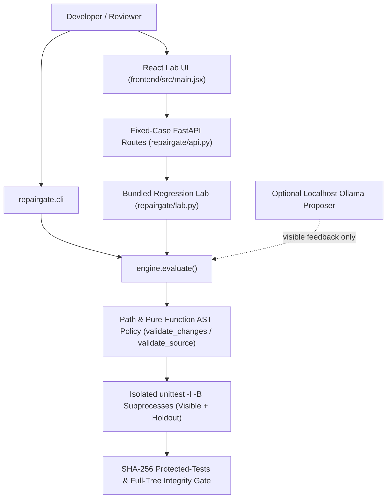
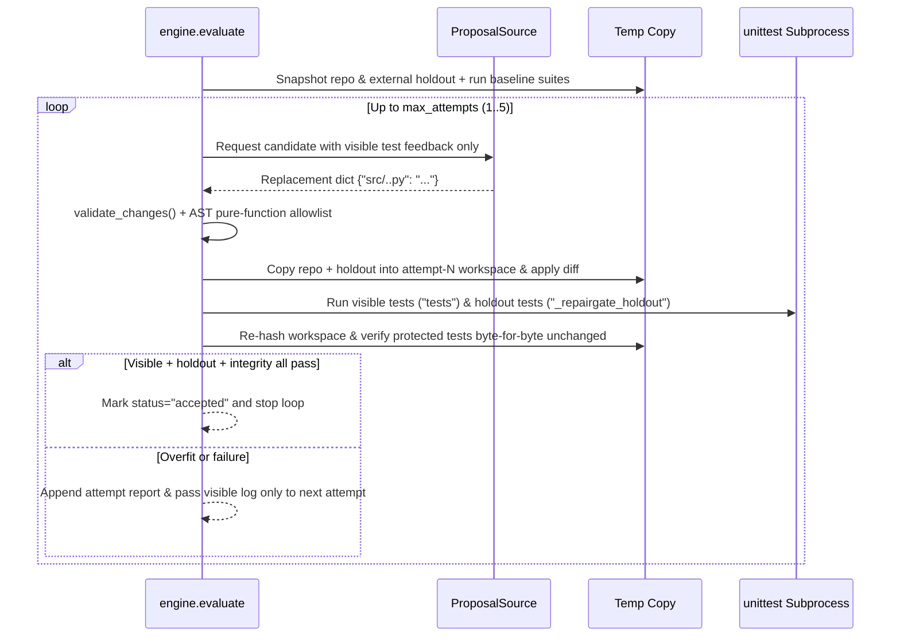

# Architecture: repairgate

Reviewed on 2026-11-08 against the local working tree (`.`). `graphify-out/graph.json` provides the local AST symbol graph.

## 1. System Context & Data Flow

Holdout-verified pure-function Python repair evaluator (CLI + FastAPI + React lab) that enforces narrow AST/path policies, executes visible and external holdout `unittest` suites in isolated child processes,withholds holdout logs from proposers to prevent overfitting, and verifies cryptographic tree integrity.



## 2. Execution & Pipeline Sequence



## 3. Module Breakdown

| Path | Responsibility |
| :--- | :--- |
| `repairgate/engine.py` | Bounded tree snapshotting (`file_digest`), pure-function AST allowlist, path containment guards, isolated `unittest` runner with process-tree kill & log truncation, holdout-shielded attempt loop, and optional localhost Ollama proposer. |
| `repairgate/demo.py` | Recorded `bill-splitter` proposals demonstrating test-tampering rejection, holdout overfitting rejection, and general repair acceptance. |
| `repairgate/lab.py` | Three-case regression lab (`bill-splitter`, `interval-merge`, `sample-window`) and summary runner. |
| `repairgate/api.py` | Localhost FastAPI endpoints (`/api/health`, `/api/cases`, `/api/demo`) guarded by a non-blocking process lock. |
| `repairgate/cli.py` | CLI commands (`demo`, `lab`, `evaluate`) exiting non-zero on rejected proposals. |
| `tests/` | 6 pytest suites (`test_engine.py`, `test_snapshot_and_policy.py`, `test_evaluate_lifecycle.py`, `test_lab.py`, `test_cli_and_api.py`, `test_provider.py`). |

## 4. State Management & Failure Handling

Candidate files are written exclusively inside `TemporaryDirectory(prefix='repairgate-')` per-attempt subdirectories; original `repo` and `holdout` trees are re-hashed at completion (`original_unchanged`). Proposers receive `attempt['visible']['log']` and high-level rejection reasons only—never holdout assertions or stack traces.

## 5. Verification Commands

```powershell
Set-Location 'python' -m pytest -q
```

## 6. Integration Boundaries

AST allowlist and temporary workspace copies enforce pure-function benchmark rules on trusted local code; they are not an OS container sandbox for untrusted code.

## Source crosscheck, 2026-11-08

The API currently uses one process-local lock for all demo cases. Candidate verification still checks the freshly copied tree against the expected baseline before applying changes. No integrity shortcut is implemented by this documentation review.
