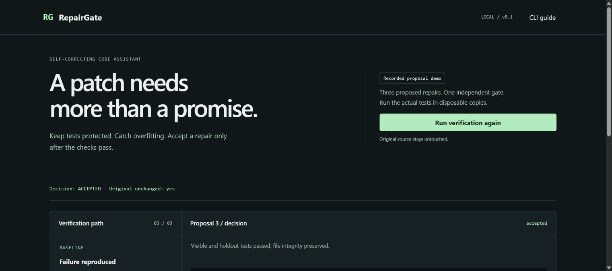

# RepairGate

A local self-correcting code assistant that keeps repair proposals separate from the acceptance decision. A candidate that passes the visible example but breaks unseen inputs is rejected. Test edits are rejected before execution.



## Try it

Windows: double-click **Run Repairgate.cmd**, or run `powershell -ExecutionPolicy Bypass -File run.ps1`. Requires Python 3.11+ and Node.js 22.12+ or 24+. Open http://127.0.0.1:8764.

Other platforms:

```sh
python -m venv .venv
source .venv/bin/activate
pip install -e '.[dev]'
cd frontend
npm ci
npm run build
cd ..
python -m uvicorn repairgate.api:app --host 127.0.0.1 --port 8764
```

## What the demo proves

The bill splitter initially loses a cent when dividing 100 cents among three people. Three **recorded**, deliberately contrasting proposals run through the actual verifier:

1. Remove a failing test: blocked by the source path policy.
2. Hardcode the visible examples: passes both visible tests, fails independent holdout checks.
3. Implement integer quotient/remainder splitting and input validation: passes visible and holdout tests.

Holdout tests check 35 input combinations, conservation, fairness, deterministic order and invalid inputs. Export the decision report to inspect diffs, test logs, source/holdout SHA256 digests and whether originals stayed unchanged. This demonstrates gate behavior, not an AI model's repair success rate.

## Local AI repair loop

The CLI can call an already-running local Ollama model. It sends the task, source and **visible** test feedback to `127.0.0.1:11434`. Holdout tests and their failure details stay out of the proposal prompt. No model download is automatic.

```sh
repairgate repair examples/bill-splitter \
  --holdout examples/holdout \
  --task "Split integer cents without losing money; reject invalid inputs" \
  --ollama qwen2.5:7b --trust-local-code --attempts 3 \
  --output repair-report.json
```

For deterministic replay, replace `--ollama MODEL` with `--proposals proposals.json`, a JSON array of dictionaries mapping source paths to complete replacement text. `repairgate demo --output repair-report.json` needs no model.

## Scope and integrity

- Focused Python utility repositories with `src/`, `tests/__init__.py` and stdlib-only unittest tests. External holdouts must include `__init__.py`.
- Only existing `src/**/*.py` files can change, at most 10 files and 100 KB per file. Tests, configuration and path traversal are blocked.
- Pure-function policy blocks imports, attribute access, classes, decorators, introspection and non-allowlisted calls. This version targets arithmetic/list utilities, not general application repair.
- Every attempt starts from the same original in a fresh temporary copy. Both test suites must discover tests and pass. File hashes must still match the expected tree after execution.
- Attempts default to three, maximum five. Each test process has a timeout. Accepted replacements are exported, **never automatically applied** to your original repository.
- Run only trusted repository code/tests. Copies and AST restrictions are **not a security sandbox** or a proof against adversarial Python. There is no memory isolation. Bind the demo to localhost. The HTTP API executes only the bundled fixture, never arbitrary uploaded code.
- Passing provided tests does not prove correctness outside their coverage. Public sample holdouts are excluded from the model prompt, but are not a sealed research benchmark.

The Ollama adapter has contract tests using controlled responses. A live model was not installed or benchmarked in this release.

## Development

```sh
pip install -e '.[dev]'
python -m pytest
cd frontend && npm ci && npm run build
```

FastAPI provides the fixed demo endpoint. React/Vite renders its audit timeline. The engine and CLI work without the web UI. See [CONTRIBUTING.md](CONTRIBUTING.md). MIT licensed.
